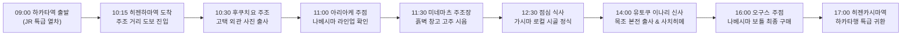

# 사가현 가시마 '나베시마(鍋島)' 양조장 순례 및 비젠하마슈쿠 방문 가이드

> **핵심 요약**: 세계적인 명주 **'나베시마(鍋島)'**의 산지인 사가현 가시마시 비젠하마슈쿠(`肥前浜宿`)를 방문할 때 반드시 알아두어야 할 **후쿠치요 주조의 견학 정책, 화요일 방문 시 주의사항, 현지 공식 특약점 구매 팁 및 유토쿠 이나리 신사 연계 출사 동선**을 정밀하게 정리한 전용 가이드입니다.

## 1. 후쿠치요 주조(富久千代酒造) 본사 방문 및 견학 정책 분석

### 1.1 일반인 내부 견학 및 본사 직접 판매 불가 (예약 불필요 / 일반 예약 불가)
- **주조장 내부 견학 불가**:
  - 후쿠치요 주조는 철저한 위생 관리와 주조 품질 유지를 위해 평소에도 **일반 관광객 대상의 주조장 내부 공개, 시음장 운영, 직접 판매를 일절 하지 않습니다.**
  - 특히 **2월은 한겨울 한창 술을 빚는 '한즈쿠리(寒造り)' 극성수기**이므로, 잡균(특히 낫토균 등) 유입을 엄격히 차단하기 위해 외부인의 양조장 내부 진입이 원천 금지됩니다.
- **예약 필요 여부**:
  - 일반 방문객을 위한 **견학 예약 시스템 자체가 존재하지 않으므로 사전 예약은 필요하지 않습니다 (예약 불가).**
  - *(참고: 주조장 내부 견학은 후쿠치요 주조가 직영하는 1박 100만 원대의 사케 오베르주 호텔 '오야도 후쿠치요 / 御宿 富久千代' 숙박객에게만 프라이빗 특전으로 제공되나, 이 숙소와 직영 레스토랑 '소안 나베시마'조차 매주 월·화요일이 정기 휴무입니다.)*

### 1.2 외관 출사 및 전통 주조 거리 탐방 (예약 불필요 / 상시 개방)
- 후쿠치요 주조 본사 건물은 국가 등록유형문화재로 지정된 유서 깊은 전통 고택입니다.
- **양조장 고택 외관 촬영과 비젠하마슈쿠 주조 거리(국가 중요 전통적 건조물군 보존지구) 골목 산책은 화요일에도 예약 없이 언제든 자유롭게 가능**합니다.

## 2. 현지 나베시마 구매 및 시음 추천 스팟 (정확한 상호명 및 구글맵)

후쿠치요 주조는 술을 본사에서 직접 판매하지 않고 **공식 계약된 '정규 특약점(주판점)'**을 통해서만 유통합니다. 가시마 현지에서 나베시마를 구매·시음할 수 있는 핵심 스팟 목록입니다.

| 상호명 (일본어 표기) | 위치 및 접근성 | 화요일 영업 여부 | 특징 및 구매 팁 | 구글맵 바로가기 |
| :--- | :--- | :---: | :--- | :---: |
| **후쿠치요 주조** (`富久千代酒造`) | 가시마시 하마마치 1244-1 | 외관 상시 개방 (내부 견학 불가) | '나베시마' 양조 본산, 등록유형문화재 고택 외관 출사 명소 | [📍 구글맵 열기](https://www.google.com/maps/search/?api=1&query=富久千代酒造+佐賀県鹿島市浜町1244-1) |
| **아리아케 주점** (`ありあけ酒店`) | 가시마시 하마마치 299-2 (후쿠치요 주조 도보 3분) | **정상 영업** (09:00 – 19:00 / 연중무휴) | 주조 거리 한가운데 위치한 전통 주점, 나베시마 공식 특약점 (가장 접근성 우수) | [📍 구글맵 열기](https://www.google.com/maps/search/?api=1&query=ありあけ酒店+佐賀県鹿島市浜町299-2) |
| **오구스 주점** (`小楠酒店`) | 가시마시 오아자모리 950-7 (히젠카시마역 차로 5분) | **정상 영업** (10:00 – 18:00 / 수요일 휴무) | **가시마 시내 최대 나베시마 라인업(블랙보틀, 클래식, 한정주) 보유 특약점** | [📍 구글맵 열기](https://www.google.com/maps/search/?api=1&query=小楠酒店+佐賀県鹿島市大字森950-7) |
| **관광주조 킨노쿠라 / 미네마츠 주조장** (`肥前屋 / 峰松酒造場`) | 가시마시 하마마치 2761-2 (비젠하마슈쿠 주조 거리 내) | **정상 영업** (09:00 – 17:00 / 연중무휴) | 흙벽 창고 장기 숙성 고주(古酒) 및 사가현 지자케 무료·유료 시음 가능 | [📍 구글맵 열기](https://www.google.com/maps/search/?api=1&query=峰松酒造場+肥前屋+佐賀県鹿島市浜町2761-2) |
| **사치히메 주조** (`幸姫酒造`) | 가시마시 후루에다코 599 (유토쿠 이나리 신사 도보 3분) | **정상 영업** (08:30 – 17:00 / 연중무휴) | 신사 봉납 어신주 및 준마이다이긴조 무료 시음, 양조장 매장 견학 | [📍 구글맵 열기](https://www.google.com/maps/search/?api=1&query=幸姫酒造+佐賀県鹿島市古枝甲599) |
| **유토쿠 이나리 신사** (`祐徳稲荷神社`) | 가시마시 후루에다오츠 1855 | 상시 개방 (신표수여소 08:30 – 16:30) | 일본 3대 이나리 신사, 절벽 위 웅장한 목조 본전과 붉은 토리이 출사 명소 | [📍 구글맵 열기](https://www.google.com/maps/search/?api=1&query=祐徳稲荷神社+佐賀県鹿島市古枝乙1855) |

## 3. 후쿠오카(하카타) ➔ 사가현 가시마 열차 이동 및 추천 당일 동선

### 3.1 열차 이동 안내 (편도 약 1시간)
- **갈 때**: **[하카타역](https://www.google.com/maps/search/?api=1&query=博多駅+福岡市博多区博多駅中央街1-1)** ➔ JR 릴레이 카모메(또는 미도리) 탑승 ➔ 다케오온센(또는 코호쿠/에키마에) 환승 ➔ **JR 나가사키 본선 [히젠하마역](https://www.google.com/maps/search/?api=1&query=肥前浜駅) (`肥前浜駅`)** 하차 (도보로 주조 거리 진입)
- **올 때**: **JR [히젠카시마역](https://www.google.com/maps/search/?api=1&query=肥前鹿島駅) (`肥前鹿島駅`)**에서 특급 열차 탑승 ➔ **[하카타역](https://www.google.com/maps/search/?api=1&query=博多駅+福岡市博多区博多駅中央街1-1)** 복귀

### 3.2 2/9(화) 추천 시간대별 완결 동선

1. **10:15 – 11:00 [[비젠하마슈쿠 주조 거리](https://www.google.com/maps/search/?api=1&query=肥前浜宿+酒蔵通り+佐賀県鹿島市浜町) & [후쿠치요 주조](https://www.google.com/maps/search/?api=1&query=富久千代酒造+佐賀県鹿島市浜町1244-1) 외관 출사]**:
   - **[히젠하마역](https://www.google.com/maps/search/?api=1&query=肥前浜駅)**에서 도보 5분 거리의 주조 거리로 이동합니다.
   - 100년 역사를 지닌 **[후쿠치요 주조](https://www.google.com/maps/search/?api=1&query=富久千代酒造+佐賀県鹿島市浜町1244-1) 고택 외관**과 옛 정취가 흐르는 골목 풍경을 촬영합니다.
2. **11:00 – 12:00 [[아리아케 주점](https://www.google.com/maps/search/?api=1&query=ありあけ酒店+佐賀県鹿島市浜町299-2) & [미네마츠 주조장](https://www.google.com/maps/search/?api=1&query=峰松酒造場+肥前屋+佐賀県鹿島市浜町2761-2)]**:
   - 후쿠치요 주조 바로 인근의 **[아리아케 주점](https://www.google.com/maps/search/?api=1&query=ありあけ酒店+佐賀県鹿島市浜町299-2)**에 들러 당일 입고된 나베시마 보틀을 확인합니다.
   - 인근 **[미네마츠 주조장(관광주조 킨노쿠라)](https://www.google.com/maps/search/?api=1&query=峰松酒造場+肥前屋+佐賀県鹿島市浜町2761-2)**에서 5 – 10년 숙성된 황금빛 비장 고주를 시음합니다.
3. **12:00 – 13:30 [[가시마 몬젠 상점가 로컬 점심 식사](https://www.google.com/maps/search/?api=1&query=祐徳門前商店街+佐賀県鹿島市)]**:
   - 신선한 사가현 쌀밥과 생선구이, 맑은 된장국이 나오는 정식집에서 든든하게 속을 채웁니다.
4. **14:00 – 15:40 [[유토쿠 이나리 신사](https://www.google.com/maps/search/?api=1&query=祐徳稲荷神社+佐賀県鹿島市古枝乙1855) & [사치히메 주조](https://www.google.com/maps/search/?api=1&query=幸姫酒造+佐賀県鹿島市古枝甲599)]**:
   - 택시나 버스로 10분 이동하여 절벽 위 붉은 목조 전각이 웅장한 **[유토쿠 이나리 신사](https://www.google.com/maps/search/?api=1&query=祐徳稲荷神社+佐賀県鹿島市古枝乙1855)**를 참배하고 출사합니다.
   - 신사 바로 앞 **[사치히메 주조](https://www.google.com/maps/search/?api=1&query=幸姫酒造+佐賀県鹿島市古枝甲599)**에 들러 신사에 봉납되는 신성한 어신주(준마이다이긴조)를 시음합니다.
5. **16:00 – 16:40 [[오구스 주점](https://www.google.com/maps/search/?api=1&query=小楠酒店+佐賀県鹿島市大字森950-7) 나베시마 최종 구매]**:
   - 히젠카시마역 방면으로 이동하며 **[오구스 주점](https://www.google.com/maps/search/?api=1&query=小楠酒店+佐賀県鹿島市大字森950-7)**에 들릅니다.
   - 가시마 시내에서 가장 구색이 풍부한 나베시마 라인업(클래식 아카이와오마치, 한정 보틀 등) 중 원하는 사케를 최종 구입합니다.
6. **17:00 [하카타 복귀]**:
   - **[히젠카시마역](https://www.google.com/maps/search/?api=1&query=肥前鹿島駅)**에서 특급 열차를 타고 편안하게 **[하카타역](https://www.google.com/maps/search/?api=1&query=博多駅+福岡市博多区博多駅中央街1-1)**으로 귀환하여 저녁 사케 바 일정을 즐깁니다.

---

**서기 2026년 10월 13일**

**백 년 세월을 품은 주조 거리의 고요와 술 빚는 장인의 묵묵한 숨결을 가슴에 담으며 기록함.**
