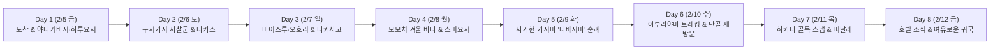

# 후쿠오카 7박 8일 출사·미식 여행 계획: 속 편한 점심 & 심야 바 1:1 매칭 가이드

> **여행 핵심 컨셉**: 낮 **3만 보 출사길**에 맞춘 **'자극 없고 속 편한 점심 3선'**과, 자정까지 느긋하게 잔을 기울인 뒤 호텔(**크로스라이프 하카타 야나기바시**)로 안전하게 도보 귀환할 수 있는 **'심야 이자카야 / 재즈·사케 바 3선'**을 7박 8일 전 일정에 걸쳐 1:1로 매칭한 상세 여정표입니다. **모든 식당과 주점은 현지 검색 및 내비게이션 연동이 즉시 가능한 실제 상호명과 직통 구글맵 핀으로 전수 검증**되었습니다.

## 1. 숙소 정보 및 7박 8일 전체 일정 요약

### 1.1 베이스캠프 숙소 정보

| 항목 | 상세 내용 | 비고 / 구글맵 |
| :--- | :--- | :--- |
| **호텔명** | **크로스라이프 하카타 야나기바시** (`クロスライフ博多柳橋` / CROSS Life Hakata Yanagibashi) | [📍 구글맵 직통 핀 열기](https://www.google.com/maps/search/?api=1&query=クロスライフ博多柳橋+福岡市中央区春吉1-6-5) |
| **숙박 일정** | **2027.02.05(금) – 2027.02.12(금)** (7박 8일) | |
| **객실 타입** | 컴포트 더블룸 (싱글 유즈, 17㎡, 시티뷰, **조식 포함**) | 에스프레소 & 베이커리 조식 |
| **위치 장점** | 야나기바시 연합시장 바로 옆 (하루요시·와타나베도리·스미요시·야쿠인 심야 도보 귀환 최적 거점) | 공항 택시 약 15분 (2,000 – 2,500엔) |

> [!NOTE]
> **후쿠오카 여행 연관 가이드 바로가기**
> - **낮 점심 10선 상세 가이드**: [후쿠오카 출사 여행 가이드: 속 편하고 담백한 점심 맛집 10선](2026-10-13-후쿠오카-출사-여행-속-편한-점심-맛집-10선.md)
> - **밤 사케 테이스팅 가이드**: [후쿠오카 여행 사케 큐레이션: 단단한 골격과 은은한 감칠맛(旨味)을 잇는 니혼슈 가이드](2026-10-13-후쿠오카-여행-추천-사케-큐레이션-가이드.md)
> - **2/9 가시마 원정 전용 가이드**: [사가현 가시마 '나베시마' 양조장 순례 및 비젠하마슈쿠 방문 가이드](2026-10-13-사가현-가시마-나베시마-순례-및-비젠하마슈쿠-방문-가이드.md)

### 1.2 7박 8일 출사 & 미식 흐름도

### 1.3 일자별 핵심 테마 한눈에 보기

| 일자 (요일) | 낮 출사 핵심 코스 (보행 목표) | 속 편한 점심 1순위 | 심야 술자리 핵심 테마 (자정 이후 도보 귀환) |
| :---: | :--- | :--- | :--- |
| **Day 1 (2/5 금)** | 공항 도착 ➔ 하루요시·와타나베도리 워밍업 (1만 보) | 야나기바시 쇼쿠도 / 우동 타이라 | 금요일 첫날밤 (하루요시 쇼쿠도 / MASQUERADE / 사보리바) |
| **Day 2 (2/6 토)** | 스미요시·쿠시다·도초지·쇼후쿠지 사찰군 (3만 보) | 요시즈카 우나기야 / 나가하마 넘버원 | 토요일 클래식 나카스 (King Fish 재즈 / 사케랩 시소) |
| **Day 3 (2/7 일)** | 케고 신사 ➔ 마이즈루 성터 ➔ 오호리 공원 | 테우치소바 야부킨 / 타이쇼테이 | 일요일 번화가 피신 (슈시 치로리 / 도도로키 사케텐 스탠드) |
| **Day 4 (2/8 월)** | 아침 쿠시다 신사 ➔ 모모치 해변 겨울 바다 & 석양 | 사누키우동 시나리 / 소바 키소지 | 월요일 밤의 고요한 온기 (사보리바 / 야키토리 야시치) |
| **Day 5 (2/9 화)** | 사가현 가시마 비젠하마슈쿠 주조 거리 & 유토쿠 이나리 | 가시마 로컬 시골 정식 / 히젠카시마 우동 | 후쿠오카 복귀 후 '나베시마' 사케 테이스팅의 밤 |
| **Day 6 (2/10 수)** | 아부라야마 전망대·미나미공원 숲길 파노라마 트레킹 | 타이쇼테이 안심카츠 / 소바도코로 마사야 | **'단골 인증의 밤'** (마음에 든 가게 두 번째 방문) |
| **Day 7 (2/11 목)** | 야나기바시 시장·스미요시·기온 골목 자유 스냅 (3만 보) | 야나기바시 쇼쿠도 / 요시즈카 우나기야 | 여행의 마지막 만찬 (단골 마스터 카운터 / 재즈 & 와인) |
| **Day 8 (2/12 금)** | 호텔 조식 및 여유로운 체크아웃 ➔ 12:00 공항 이동 | 호텔 조식 (에스프레소 & 빵) | 15:00 항공편 귀국 |

## 2. 주요 심야 주점 · 재즈 · 사케 바 정밀 구글맵 핀

자정부터 새벽까지 느긋하게 머물다 호텔(크로스라이프 하카타 야나기바시)로 걸어서 안전하게 귀환할 수 있는 핵심 심야 아지트 목록입니다.

| 실제 상호명 (일본어 표기) | 정확한 현지 주소 (도보 시간) | 공간 성격 및 특징 | 구글맵 직통 핀 |
| :--- | :--- | :--- | :---: |
| **하루요시 쇼쿠도** (`ハルよし食童`) | 福岡市中央区春吉3-23-27 (호텔 도보 5 – 7분) | 마스터와 단골이 도란도란 모이는 심야 식당 겸 이자카야 (명물 조개국·소주) | [📍 구글맵](https://www.google.com/maps/search/?api=1&query=ハルよし食童+福岡市中央区春吉3-23-27) |
| **MASQUERADE** (`マスカレード`) | 福岡市中央区今泉1-20-22 1F (호텔 도보 8 – 10분) | 차분한 LP·재즈·라이브 선율 속에서 즐기는 칵테일·와인 바 | [📍 구글맵](https://www.google.com/maps/search/?api=1&query=MASQUERADE+福岡市中央区今泉1-20-22) |
| **사보리바** (`和酒バー SABORIBA`) | 福岡市博多区住吉2-12-10 (호텔 도보 6 – 8분) | 새벽까지 편안하게 일본주(화주)와 고마사바 등 안주를 즐기는 심야 카운터 바 | [📍 구글맵](https://www.google.com/maps/search/?api=1&query=和酒バー+SABORIBA+福岡市博多区住吉2-12-10) |
| **Jazz Club KINGFISH** (`キングフィッシュ`) | 福岡市中央区大名1-1-10 2F (택시 5분 / 도보 18분) | 수준 높은 라이브 재즈 연주와 칵테일·와인을 즐기는 정통 재즈 클럽 & 바 (새벽 1시까지) | [📍 구글맵](https://www.google.com/maps/search/?api=1&query=Jazz+Club+KINGFISH+福岡市中央区大名1-1-10) |
| **Sake Lab FUKUOKA seesaw** (`サケ ラボ シーソー`) | 福岡市博多区中洲5-3-17 1F (호텔 도보 12 – 15분) | 기키자케시(사케 소믈리에)가 엄선한 규슈 명주·지자케 글라스 테이스팅 바 | [📍 구글맵](https://www.google.com/maps/search/?api=1&query=Sake+Lab+FUKUOKA+seesaw+福岡市博多区中洲5-3-17) |
| **슈시 치로리** (`酒肆 ちろり`) | 福岡市中央区渡辺通2-3-34 (삼각시장 내, 도보 6분) | 레트로 삼각시장 안쪽 L자 카운터 7석, 전국 25종 엄선 지자케 전문 사케 바 | [📍 구글맵](https://www.google.com/maps/search/?api=1&query=酒肆+ちろり+福岡市中央区渡辺通2-3-34) |
| **야키토리 야시치** (`焼鳥 弥七`) | 福岡市中央区春吉3-12-22 (호텔 도보 6분 하루요시 골목) | 카운터에서 장인이 숯불로 정성껏 구워내는 은은한 야키토리 & 사케 돗쿠리 | [📍 구글맵](https://www.google.com/maps/search/?api=1&query=焼鳥+弥七+福岡市中央区春吉3-12-22) |
| **도도로키 사케텐 야쿠인 스탠드** (`とどろき酒店 薬院スタンド`) | 福岡市中央区薬院1-9-5 1F (호텔 도보 7분) | 세련된 내추럴 와인 & 규슈 명주 큐레이션 바 겸 스탠딩 테이스팅 샵 | [📍 구글맵](https://www.google.com/maps/search/?api=1&query=とどろき酒店+薬院スタンド+福岡市中央区薬院1-9-5) |

## 3. 일자별 상세 동선 및 점심 · 심야 주점 1:1 매칭

### Day 1 [2/5 금]: 후쿠오카 도착 & 야나기바시 골목 첫날밤

- **오후 이동 및 출사 동선**:
  - **15:00** 후쿠오카 공항 도착 ➔ **택시 직행** (약 15분 소요, `2,000 – 2,500엔`)
  - **[크로스라이프 하카타 야나기바시](https://www.google.com/maps/search/?api=1&query=クロスライフ博多柳橋+福岡市中央区春吉1-6-5)** 체크인 및 카메라 장비 세팅
  - 해 질 녘 **와타나베도리 / 하루요시 골목** 워밍업 스냅 산책 (약 1만 보)

| 구분 | 순위 | 추천 장소 (정식 상호명 및 위치) | 추천 메뉴 및 포인트 | 구글맵 직통 핀 |
| :---: | :---: | :--- | :--- | :---: |
| **점심 / 간식** (도착 후 가벼운 식사) | **1** | **야나기바시 쇼쿠도** (`柳橋食堂`, 도보 2분) | 담백한 카이센동 & 조미료 없는 맑은 생선 장국 | [📍 지도](https://www.google.com/maps/search/?api=1&query=柳橋食堂+福岡市中央区春吉1-1-10) |
| | **2** | **우동 타이라** (`うどん平`, 스미요시) | 멸치·다시마·날치 육수의 맑고 부드러운 수타 우동 | [📍 지도](https://www.google.com/maps/search/?api=1&query=うどん平+福岡市博多区住吉5-10-7) |
| | **3** | **카레혼포 하카타 본점** (`伽哩本舗 博多本店`) | 양파와 육수로만 단맛을 낸 부드러운 수제 카레 | [📍 지도](https://www.google.com/maps/search/?api=1&query=伽哩本舗+博多本店+福岡市博多区上川端町6-135) |
| **저녁 술자리** (금요일 심야 / 도보 5 – 10분) | **1** | **하루요시 쇼쿠도** (`ハルよし食童`) | 마스터와 단골이 도란도란 모이는 심야 식당 겸 이자카야 | [📍 지도](https://www.google.com/maps/search/?api=1&query=ハルよし食童+福岡市中央区春吉3-23-27) |
| | **2** | **MASQUERADE** (`マスカレード`, 이마이즈미) | 차분한 LP / 재즈 선율의 칵테일·와인 바 | [📍 지도](https://www.google.com/maps/search/?api=1&query=MASQUERADE+福岡市中央区今泉1-20-22) |
| | **3** | **사보리바** (`和酒バー SABORIBA`, 스미요시) | 새벽 3시까지 편안하게 잔을 기울이는 심야 카운터 바 | [📍 지도](https://www.google.com/maps/search/?api=1&query=和酒バー+SABORIBA+福岡市博多区住吉2-12-10) |

### Day 2 [2/6 토]: 하카타 구시가지 사찰군 출사 & 클래식 나카스

- **낮 출사 동선 (목표 3만 보)**:
  - 호텔 출발 ➔ **[스미요시 신사](https://www.google.com/maps/search/?api=1&query=住吉神社+福岡市博多区)** ➔ **[쿠시다 신사](https://www.google.com/maps/search/?api=1&query=櫛田神社+福岡)** ➔ **[도초지](https://www.google.com/maps/search/?api=1&query=東長寺+福岡)** ➔ **[쇼후쿠지](https://www.google.com/maps/search/?api=1&query=聖福寺+福岡)** 고즈넉한 목조 건축 및 사찰 빛 그림자 출사

| 구분 | 순위 | 추천 장소 (정식 상호명 및 위치) | 추천 메뉴 및 포인트 | 구글맵 직통 핀 |
| :---: | :---: | :--- | :--- | :---: |
| **점심 추천** (맑은 속풀이) | **1** | **하카타 나다이 요시즈카 우나기야** (나카스) | 시원한 장어 간 국(스이모노) & 은은한 전통 장어덮밥 | [📍 지도](https://www.google.com/maps/search/?api=1&query=博多名代+吉塚うなぎ屋+福岡市博多区中洲2-8-27) |
| | **2** | **나가하마 넘버원 기온점** (기온) | 클래식 돈코츠 라멘 (`"우스메 / 간 연하게"` 요청) | [📍 지도](https://www.google.com/maps/search/?api=1&query=長浜ナンバーワン+祇園店+福岡市博多区祇園町4-64) |
| | **3** | **사누키우동 시나리** (`讃岐うどん 志成`, 오테몬) | 감칠맛 나는 이리코(멸치) 육수 온우동 | [📍 지도](https://www.google.com/maps/search/?api=1&query=讃岐うどん+志成+福岡市中央区大手門3-3-24) |
| **저녁 술자리** (나카스 및 호텔 귀환길) | **1** | **Jazz Club KINGFISH** (다이묘) | 수준 높은 라이브 재즈 클럽 & 바 (새벽 1시까지 영업) | [📍 지도](https://www.google.com/maps/search/?api=1&query=Jazz+Club+KINGFISH+福岡市中央区大名1-1-10) |
| | **2** | **Sake Lab FUKUOKA seesaw** (나카스) | 엄선된 프리미엄 지자케(지역 사케) 글라스 테이스팅 바 | [📍 지도](https://www.google.com/maps/search/?api=1&query=Sake+Lab+FUKUOKA+seesaw+福岡市博多区中洲5-3-17) |
| | **3** | **야키토리 야시치** (`焼鳥 弥七`, 하루요시) | 귀환길 은은한 숯불 꼬치에 따뜻한 사케 돗쿠리 한 잔 | [📍 지도](https://www.google.com/maps/search/?api=1&query=焼鳥+弥七+福岡市中央区春吉3-12-22) |

### Day 3 [2/7 일]: 마이즈루 성터 조망 & 다카사고 골목

- **낮 출사 동선**:
  - **[케고 신사](https://www.google.com/maps/search/?api=1&query=警固神社+福岡)** ➔ **[마이즈루 공원 천수대 터](https://www.google.com/maps/search/?api=1&query=舞鶴公園+天守台+福岡)**(후쿠오카 시내 파노라마 조망) ➔ **[오호리 공원](https://www.google.com/maps/search/?api=1&query=大濠公園+福岡)** 호수 산책 출사

| 구분 | 순위 | 추천 장소 (정식 상호명 및 위치) | 추천 메뉴 및 포인트 | 구글맵 직통 핀 |
| :---: | :---: | :--- | :--- | :---: |
| **점심 추천** (공원 산책로 주변) | **1** | **테우치소바 야부킨** (`手打ち蕎麦 やぶ金`, 다이묘) | 메밀향 가득한 판모밀(세이로) & 속 데우는 뜨거운 면수(소바유) | [📍 지도](https://www.google.com/maps/search/?api=1&query=手打ち蕎麦+やぶ金+福岡市中央区大名1-3-5) |
| | **2** | **쿠로부타카츠레츠 타이쇼테이** (아카사카) | 소금 찍어 먹는 담백하고 바삭한 가고시마 흑돼지 카츠 | [📍 지도](https://www.google.com/maps/search/?api=1&query=黒ブタかつれつ+大正亭+福岡市中央区赤坂1-3-16) |
| | **3** | **하카타 신신라멘 텐진본점** (텐진) | 닭뼈·채소 육수를 블렌딩한 마일드 돈코츠 | [📍 지도](https://www.google.com/maps/search/?api=1&query=博多らーめん+Shin-Shin+天神本店+福岡市中央区天神3-2-19) |
| **저녁 술자리** (일요일 인파 피신 / 남쪽 도보 5 – 8분) | **1** | **슈시 치로리** (`酒肆 ちろ리`, 삼각시장) | 번화가를 피해 L자 카운터에서 마스터가 차분히 권하는 명품 사케 | [📍 지도](https://www.google.com/maps/search/?api=1&query=酒肆+ちろり+福岡市中央区渡辺通2-3-34) |
| | **2** | **도도로키 사케텐 야쿠인 스탠드** (야쿠인) | 카운터 중심의 글라스 내추럴 와인 & 엄선 지자케 스탠딩 바 | [📍 지도](https://www.google.com/maps/search/?api=1&query=とどろき酒店+薬院スタンド+福岡市中央区薬院1-9-5) |
| | **3** | **하루요시 쇼쿠도** (`ハルよし食童`, 하루요시) | 일요일 밤 늦은 시간에도 편안하게 받아주는 심야 안식처 | [📍 지도](https://www.google.com/maps/search/?api=1&query=ハルよし食童+福岡市中央区春吉3-23-27) |

### Day 4 [2/8 월]: 모모치 해변 겨울 빛 & 롯폰마쓰

- **낮 출사 동선**:
  - 이른 아침 고요한 **[쿠시다 신사](https://www.google.com/maps/search/?api=1&query=櫛田神社+福岡)** 아침 빛 촬영 ➔ **[모모치 해변공원](https://www.google.com/maps/search/?api=1&query=シーサイドももち海浜公園+福岡)** 겨울 바다 & 석양 역광 실루엣 출사

| 구분 | 순위 | 추천 장소 (정식 상호명 및 위치) | 추천 메뉴 및 포인트 | 구글맵 직통 핀 |
| :---: | :---: | :--- | :--- | :---: |
| **점심 추천** (모모치 / 오호리 방면) | **1** | **사누키우동 시나리** (`讃岐うどん 志成`, 오테몬) | 개운한 멸치 육수 온우동 & 반숙 계란튀김 붓카케 우동 | [📍 지도](https://www.google.com/maps/search/?api=1&query=讃岐うどん+志成+福岡市中央区大手門3-3-24) |
| | **2** | **소바 키소지** (`蕎麦 木曽路`, 아라토) | 바닷바람 맞은 후 속을 따뜻하게 데워주는 40년 전통 온소바 | [📍 지도](https://www.google.com/maps/search/?api=1&query=蕎麦+木曽路+福岡市中央区荒戸1-10-13) |
| | **3** | **카레혼포 하카타 본점** (`伽哩本舗 博多本店`) | 푹 고아낸 사골·채소 베이스의 부드러운 수제 카레 | [📍 지도](https://www.google.com/maps/search/?api=1&query=伽哩本舗+博多本店+福岡市博多区上川端町6-135) |
| **저녁 술자리** (월요일 밤의 고요 / 호텔 인근) | **1** | **사보리바** (`和酒バー SABORIBA`, 스미요시) | 번잡함 없이 아늑하게 머무는 심야 화주(일본주) 카운터 | [📍 지도](https://www.google.com/maps/search/?api=1&query=和酒バー+SABORIBA+福岡市博多区住吉2-12-10) |
| | **2** | **야키토리 야시치** (`焼鳥 弥七`, 하루요시) | 정갈한 오토오시(기본 안주)와 동네 단골들의 숨은 숯불 야키토리 | [📍 지도](https://www.google.com/maps/search/?api=1&query=焼鳥+弥七+福岡市中央区春吉3-12-22) |
| | **3** | **MASQUERADE** (`マスカレード`, 이마이즈미) | 차분한 재즈와 와인으로 월요일 밤을 정리하는 시간 | [📍 지도](https://www.google.com/maps/search/?api=1&query=MASQUERADE+福岡市中央区今泉1-20-22) |

### Day 5 [2/9 화]: 사가현 가시마 '나베시마(鍋島)' 순례의 날

- **낮 근교 출사 동선 (사가현 가시마시)**:
  - 하카타역에서 JR 특급 열차 탑승 ➔ **[히젠카시마역](https://www.google.com/maps/search/?api=1&query=肥前鹿島駅)** / **[히젠하마역](https://www.google.com/maps/search/?api=1&query=肥前浜駅)** 이동
  - **[비젠하마슈쿠 주조 거리(肥前浜宿 酒蔵通り)](https://www.google.com/maps/search/?api=1&query=肥前浜宿+酒蔵通り+佐賀県鹿島市)**: 세계적인 명주 **'나베시마(鍋島)'**를 빚는 **[후쿠치요 주조(富久千代酒造)](https://www.google.com/maps/search/?api=1&query=富久千代酒造+佐賀県鹿島市浜町1244-1)** 본산 외관 출사
  - 도보 3분 거리 **[아리아케 주점(ありあけ酒店)](https://www.google.com/maps/search/?api=1&query=ありあけ酒店+佐賀県鹿島市浜町299-2)** 및 **[미네마츠 주조장(관광주조 킨노쿠라)](https://www.google.com/maps/search/?api=1&query=峰松酒造場+肥前屋+佐賀県鹿島市浜町2761-2)** 방문
  - **[유토쿠 이나리 신사(祐徳稲荷神社)](https://www.google.com/maps/search/?api=1&query=祐徳稲荷神社+佐賀県鹿島市古枝乙1855)** 목조 본전 출사 & 바로 앞 **[사치히메 주조(幸姫酒造)](https://www.google.com/maps/search/?api=1&query=幸姫酒造+佐賀県鹿島市古枝甲599)** 어신주 시음
  - 귀환 전 역 인근 최대 나베시마 특약점 **[오구스 주점(小楠酒店)](https://www.google.com/maps/search/?api=1&query=小楠酒店+佐賀県鹿島市大字森950-7)**에서 나베시마 보틀 최종 구매

> [!IMPORTANT]
> **2/9(화) 나베시마 양조장(후쿠치요 주조) 방문 시 필수 확인 사항**
> - **주조장 내부 견학 및 일반 직판 불가**: 후쿠치요 주조 본사는 2월 양조 성수기(한즈쿠리) 위생 관리로 일반인 대상 내부 견학, 시음장, 직접 판매를 운영하지 않습니다. (일반 견학 예약 시스템 자체가 없으므로 예약 불필요)
> - **외관 출사 및 전통 거리 산책**: 등록유형문화재 고택 외관과 비젠하마슈쿠 주조 거리는 예약 없이 언제든 자유롭게 출사 및 산책이 가능합니다.
> - **나베시마 현지 구매 추천**: 양조장 도보 3분 거리의 공식 특약점 **[아리아케 주점](https://www.google.com/maps/search/?api=1&query=ありあけ酒店+佐賀県鹿島市浜町299-2)**(화요일 정상 영업, 09:00 – 19:00) 및 히젠카시마역 인근 최대 라인업 특약점 **[오구스 주점](https://www.google.com/maps/search/?api=1&query=小楠酒店+佐賀県鹿島市大字森950-7)**(화요일 정상 영업, 10:00 – 18:00)을 이용하시면 됩니다.

| 구분 | 순위 | 추천 장소 (정식 상호명 및 위치) | 추천 메뉴 및 포인트 | 구글맵 직통 핀 |
| :---: | :---: | :--- | :--- | :---: |
| **점심 추천** (가시마 현지 백반 & 우동) | **1** | **가시마 로컬 시골 정식집** (스시마사 / 몬젠 상점가) | 윤기 흐르는 사가현 쌀밥과 맑은 된장국, 생선구이 백반 | [📍 지도](https://www.google.com/maps/search/?api=1&query=祐徳門前商店街+佐賀県鹿島市) |
| | **2** | **히젠카시마 역전 맑은 우동집** (역 앞) | 열차 환승 전 가볍고 따뜻하게 속을 채우는 면 요리 | [📍 지도](https://www.google.com/maps/search/?api=1&query=肥前鹿島駅+佐賀県鹿島市) |
| | **3** | **미네마츠 주조장 킨노쿠라** (비젠하마슈쿠) | 100년 흙벽 저장고에서 숙성된 황금빛 비장 고주 시음 | [📍 지도](https://www.google.com/maps/search/?api=1&query=峰松酒造場+肥前屋+佐賀県鹿島市浜町2761-2) |
| **저녁 술자리** (후쿠오카 복귀 후 사케의 밤) | **1** | **사보리바** (`和酒バー SABORIBA`, 스미요시) | 낮에 보고 온 **'나베시마(블랙보틀 등)'** 라인업을 갖춘 아늑한 카운터 | [📍 지도](https://www.google.com/maps/search/?api=1&query=和酒バー+SABORIBA+福岡市博多区住吉2-12-10) |
| | **2** | **Sake Lab FUKUOKA seesaw** (나카스) | 규슈 명주와 나베시마를 글라스로 심도 있게 비교 테이스팅 | [📍 지도](https://www.google.com/maps/search/?api=1&query=Sake+Lab+FUKUOKA+seesaw+福岡市博多区中洲5-3-17) |
| | **3** | **슈시 치로리** (`酒肆 ちろり`, 삼각시장) | 제철 사시미 한 점과 따뜻한 온사케(아츠캉) 한 잔 | [📍 지도](https://www.google.com/maps/search/?api=1&query=酒肆+ちろり+福岡市中央区渡辺通2-3-34) |

### Day 6 [2/10 수]: 아부라야마 전망 트레킹 & 단골집 "두 번째 방문"

- **낮 출사 동선**:
  - **[아부라야마 전망대(ABURAYAMA FUKUOKA)](https://www.google.com/maps/search/?api=1&query=ABURAYAMA+FUKUOKA+福岡市南区)** 또는 **[미나미공원](https://www.google.com/maps/search/?api=1&query=南公園+福岡市中央区)** 숲길 트레킹 후 후쿠오카 도심 파노라마 촬영

| 구분 | 순위 | 추천 장소 (정식 상호명 및 위치) | 추천 메뉴 및 포인트 | 구글맵 직통 핀 |
| :---: | :---: | :--- | :--- | :---: |
| **점심 추천** (트레킹 후 속 편한 보충) | **1** | **쿠로부타카츠레츠 타이쇼테이** (아카사카) | 숲길 보행 후 양질의 단백질을 채우는 부드러운 흑돼지 안심 카츠 | [📍 지도](https://www.google.com/maps/search/?api=1&query=黒ブタかつれつ+大正亭+福岡市中央区赤坂1-3-16) |
| | **2** | **소바도코로 마사야** (`そば処 まさや`, 야쿠인) | 구수한 면수(소바유)와 함께 즐기는 정갈한 판모밀 | [📍 지도](https://www.google.com/maps/search/?api=1&query=そば処+まさや+福岡市中央区薬院2-10-1) |
| | **3** | **우메야마 텟페이 쇼쿠도 渡辺通本店** (와타나베도리) | 생선 소금구이, 삼삼한 일본식 계란말이, 미소시루 | [📍 지도](https://www.google.com/maps/search/?api=1&query=梅山鉄平食堂+本店+福岡市中央区渡辺通3-6-1) |
| **저녁 술자리** ("단골 인증의 밤") | **1** | **앞선 일정 중 가장 마음에 든 가게 재방문** | 두 번째 방문 인사를 건네고 마스터 추천 숨은 술 청하기 | - |
| | **2** | **Jazz Club KINGFISH** (다이묘) | 묵직한 라이브 재즈와 함께 즐기는 와인 / 칵테일 | [📍 지도](https://www.google.com/maps/search/?api=1&query=Jazz+Club+KINGFISH+福岡市中央区大名1-1-10) |
| | **3** | **하루요시 쇼쿠도** (`ハルよし食童`, 하루요시) | 마스터와 두런두런 대화하며 자정까지 편안히 머물기 | [📍 지도](https://www.google.com/maps/search/?api=1&query=ハルよし食童+福岡市中央区春吉3-23-27) |

### Day 7 [2/11 목]: 하카타 시장 · 골목 스냅 출사 & 피날레

- **낮 출사 동선 (3만 보 피날레)**:
  - 아침 **[야나기바시 연합시장](https://www.google.com/maps/search/?api=1&query=柳橋連合市場+福岡)** 삶의 풍경 ➔ **스미요시 골목** ➔ **기온 골목** 자유 스냅 출사

| 구분 | 순위 | 추천 장소 (정식 상호명 및 위치) | 추천 메뉴 및 포인트 | 구글맵 직통 핀 |
| :---: | :---: | :--- | :--- | :---: |
| **점심 추천** (마지막 날 속풀이 식사) | **1** | **야나기바시 쇼쿠도** (`柳橋食堂`, 도보 2분) | 제철 카이센동 & 생선 서덜을 우려낸 맑은 국(아라지루) | [📍 지도](https://www.google.com/maps/search/?api=1&query=柳橋食堂+福岡市中央区春吉1-1-10) |
| | **2** | **하카타 나다이 요시즈카 우나기야** (나카스) | 맑은 장어 간 국과 함께하는 든든한 피날레 장어덮밥 | [📍 지도](https://www.google.com/maps/search/?api=1&query=博多名代+吉塚うなぎ屋+福岡市博多区中洲2-8-27) |
| | **3** | **카레혼포 하카타 본점** (`伽哩本舗 博多本店`) | 위장을 편안하게 감싸는 자극 없는 홈메이드 카레 | [📍 지도](https://www.google.com/maps/search/?api=1&query=伽哩本舗+博多本店+福岡市博多区上川端町6-135) |
| **저녁 술자리** (여행의 마지막 만찬) | **1** | **가장 마음 통한 1인 마스터 카운터 구석** | 여행의 마지막 밤을 알리며 아쉬움 없이 느긋하게 잔 비우기 | - |
| | **2** | **MASQUERADE** (`マスカレード`, 이마이즈미) | 재즈 선율 속 와인 한 잔과 함께 7일간의 출사 사진 갈무리 | [📍 지도](https://www.google.com/maps/search/?api=1&query=MASQUERADE+福岡市中央区今泉1-20-22) |
| | **3** | **사보리바** (`和酒バー SABORIBA`, 스미요시) | 자정을 넘겨 새벽으로 이어지는 차분한 온기 | [📍 지도](https://www.google.com/maps/search/?api=1&query=和酒バー+SABORIBA+福岡市博多区住吉2-12-10) |

### Day 8 [2/12 금]: 여유로운 귀국

| 시간 | 일정 및 동선 | 상세 내용 및 참고사항 |
| :---: | :--- | :--- |
| **오전** | **호텔 조식 및 체크아웃 준비** | 호텔 조식(에스프레소 & 갓 구운 빵)을 여유롭게 즐긴 뒤 카메라 장비 및 짐 정리 |
| **12:00** | **호텔 앞 택시 탑승 ➔ 공항 이동** | 호텔 정문에서 택시 탑승 (후쿠오카 공항 국제선까지 **약 15분 소요, 2,000 – 2,500엔**) |
| **15:00** | **후쿠오카 공항 출발 (귀국)** | 출국 수속 및 면세점 확인 후 15:00 항공편으로 편안하게 귀국 |

---

**서기 2026년 10월 13일**

**낮에는 겨울 빛을 담은 3만 보의 시선을, 밤에는 잔잔한 재즈와 사케 한 잔의 여백을 누리는 품위 있는 여정이 되기를 바라며 기록함.**
