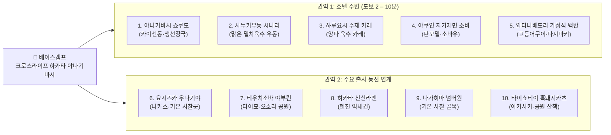

# 후쿠오카 출사 여행 가이드: 속 편하고 담백한 점심 맛집 10선

> **가이드 컨셉**: 매일 **3만 보 이상 걷는 출사 일정**과 저녁 음주 후에도 위장에 무리를 주지 않는 **'자극적이지 않고 속 편한 점심 맛집 10선'**입니다. 베이스캠프 숙소인 **크로스라이프 하카타 야나기바시** 도보권(5곳)과 주요 출사지 동선(5곳)에 맞추어 구성했습니다.

> [!TIP]
> **주문 시 필수 꿀팁 (염도 조절 요청)**
> 일본 국물이나 간이 다소 짜게 느껴질 때는 주문할 때 아래 문장을 말씀하시면 훨씬 자극 없이 편안하게 드실 수 있습니다.
> - **일본어 표현**: **"우스메데 오네가이시마스"** (`薄めでお願いします`)
> - **의미**: *"간을 싱겁게(연하게) 해주세요."*

## 1. 베이스캠프 및 맛집 10선 한눈에 보기 (구글맵 바로가기)

### 1.1 베이스캠프 숙소
- **숙소명**: **크로스라이프 하카타 야나기바시** (`クロスライフ博多柳橋` / Cross Life Hakata Yanagibashi)
- **주소**: 〒810-0003 福岡県福岡市中央区春吉1-6-5
- **위치 확인**: [📍 구글맵에서 호텔 위치 열기](https://www.google.com/maps/search/?api=1&query=クロスライフ博多柳橋+福岡市中央区春吉1-6-5)

### 1.2 권역 및 출사 동선 다이어그램

### 1.3 전체 10선 빠른 요약 및 구글맵 링크 표

| 번호 | 식당명 (일본어 표기) | 권역 / 출사 동선 | 대표 메뉴 (속 편한 포인트) | 구글맵 바로가기 |
| :---: | :--- | :--- | :--- | :---: |
| **1** | **야나기바시 쇼쿠도** (`柳橋食堂`) | 호텔 바로 뒤편 (도보 2분) | 신선한 카이센동, 조미료 없는 맑은 생선 장국(아라지루) | [📍 구글맵](https://www.google.com/maps/search/?api=1&query=柳橋食堂+福岡市中央区春吉1-1-10) |
| **2** | **사누키우동 시나리** (`讃岐うどん 志成`) | 오테몬·오호리 공원 방면 (또는 인근 맑은 우동집) | 은은한 이리코(멸치·다시마) 육수 온우동, 붓카케 우동 | [📍 구글맵](https://www.google.com/maps/search/?api=1&query=讃岐うどん+志成+福岡市中央区大手門3-3-24) |
| **3** | **하루요시 수제 카레 전문점** (`伽哩本舗` / `春吉 カレー`) | 호텔 북쪽 하루요시 골목 (도보 5 – 7분) | 양파를 오래 볶고 육수를 우려낸 부드러운 수제 카레 | [📍 구글맵](https://www.google.com/maps/search/?api=1&query=福岡市中央区春吉+カレー) |
| **4** | **야쿠인 자가제면 소바집** (`ウエスト 薬院店` / `あずま`) | 호텔 서쪽 야쿠인 방면 (도보 7 – 8분) | 슴슴한 세이로(판모밀) 소바와 해장에 좋은 뜨거운 면수(소바유) | [📍 구글맵](https://www.google.com/maps/search/?api=1&query=福岡市中央区薬院+蕎麦) |
| **5** | **하루요시·와타나베도리 가정식 백반** (`梅山鉄平食堂 本店` 등) | 호텔 인근 직장인 골목 (도보 4 – 5분) | 삼삼한 고등어 소금구이, 일본식 계란말이(다시마키), 맑은 된장국 | [📍 구글맵](https://www.google.com/maps/search/?api=1&query=梅山鉄平食堂+本店+福岡市中央区渡辺通3-6-1) |
| **6** | **요시즈카 우나기야** (`博多名代 吉塚うなぎ屋`) | 나카스 강변 (기온 사찰군 출사 동선) | 과하게 달거나 짜지 않은 전통 장어구이, 장어 간 맑은 국(스이모노) | [📍 구글맵](https://www.google.com/maps/search/?api=1&query=博多名代+吉塚うなぎ屋+福岡市博多区中洲2-8-27) |
| **7** | **테우치소바 야부킨** (`手打ち蕎麦 やぶ金`) | 다이묘 골목 (마이즈루·오호리 공원 동선) | 세이로 소바, 계란을 푼 따뜻한 타마고토지 소바 | [📍 구글맵](https://www.google.com/maps/search/?api=1&query=手打ち蕎麦+やぶ金+福岡市中央区大名1-3-5) |
| **8** | **하카타 신신라멘 텐진본점** (`博多らーめん Shin-Shin`) | 텐진 본점 외 주요 역세권 | 잡내·기름기를 잡은 닭뼈·채소 블렌딩 마일드 돈코츠 (파 추가 추천) | [📍 구글맵](https://www.google.com/maps/search/?api=1&query=博多らーめん+Shin-Shin+天神本店+福岡市中央区天神3-2-19) |
| **9** | **나가하마 넘버원 기온점** (`長浜ナンバーワン 祇園店`) | 기온역 인근 사찰 골목 | 어시장 스타일의 맑고 가벼운 클래식 돈코츠 (`우스메` 요청 추천) | [📍 구글맵](https://www.google.com/maps/search/?api=1&query=長浜ナンバーワン+祇園店+福岡市博多区祇園町4-64) |
| **10** | **쿠로부타카츠레츠 타이쇼테이** (`黒ブタかつれつ 大正亭`) | 아카사카역 인근 (공원 산책 동선) | 가고시마산 흑돼지 카츠레츠 (소스 대신 소금·겨자, 맑은 장국) | [📍 구글맵](https://www.google.com/maps/search/?api=1&query=黒ブタかつれつ+大正亭+福岡市中央区赤坂1-3-16) |

## 2. 호텔 주변 맛집 5선 (도보 2 – 10분 거리)

아침 일찍 출사를 나서기 전이나, 오전 촬영을 마치고 호텔 근처로 돌아와 조용하고 편안하게 속을 채우기 좋은 식당들입니다.

### 2.1 야나기바시 연합시장 생선식당 (야나기바시 쇼쿠도 등)
- **위치**: 호텔 바로 뒤편 야나기바시 연합시장(`柳橋連合市場`) 내부 (**도보 2분**)
- **특징 및 추천 포인트**:
  - 당일 아침 시장에 입고된 신선한 횟감을 올린 담백한 **카이센동(해산물 덮밥)**과 조미료 없이 끓여낸 **맑은 생선 장국(아라지루)**이 일품입니다.
  - 기름기가 전혀 없어 가볍고 개운한 아침 겸 점심 식사로 제격입니다.
- **구글맵 링크**:
  - [📍 야나기바시 쇼쿠도 (柳橋食堂) 구글맵 열기](https://www.google.com/maps/search/?api=1&query=柳橋食堂+福岡市中央区春吉1-1-10)
  - [📍 야나기바시 연합시장 (柳橋連合市場) 구글맵 열기](https://www.google.com/maps/search/?api=1&query=柳橋連合市場+福岡)

### 2.2 사누키우동 시나리 (讃岐うどん 志成) 및 인근 맑은 우동집
- **위치**: 오테몬 / 오호리 공원 방면 (또는 호텔 인근 맑은 우동 전문점)
- **특징 및 추천 포인트**:
  - 짜지 않고 은은하며 맑은 **이리코(멸치·다시마) 육수**와 매끄럽고 쫄깃한 수타 면발이 조화를 이룹니다.
  - 전날 음주 후 속을 달래주는 **따뜻한 온우동**이나, 반숙 계란튀김을 얹은 **붓카케 우동**을 추천합니다.
- **구글맵 링크**:
  - [📍 사누키우동 시나리 (讃岐うどん 志成) 구글맵 열기](https://www.google.com/maps/search/?api=1&query=讃岐うどん+志成+福岡市中央区大手門3-3-24)
  - [📍 호텔 주변(하루요시·와타나베도리) 우동집 구글맵 검색](https://www.google.com/maps/search/?api=1&query=福岡市中央区春吉+うどん)

### 2.3 하루요시 수제 카레 전문점 (카레혼포 하루요시 등)
- **위치**: 호텔 북쪽 하루요시 골목길 (**도보 5 – 7분**)
- **특징 및 추천 포인트**:
  - 자극적인 인스턴트 루의 짠맛 대신, 양파를 오랜 시간 볶아 단맛을 내고 육수를 깊이 우려낸 **부드럽고 깊은 풍미의 수제 카레**를 선보입니다.
  - 1인 카운터석 위주로 되어 있어 출사 중간에 조용히 혼자 또는 소수로 식사하기 좋습니다.
- **구글맵 링크**:
  - [📍 하루요시 골목 수제 카레 전문점 구글맵 검색](https://www.google.com/maps/search/?api=1&query=福岡市中央区春吉+カレー)
  - [📍 카레혼포 하카타 본점 (伽哩本舗 博多本店) 구글맵 열기](https://www.google.com/maps/search/?api=1&query=伽哩本舗+博多本店+福岡)

### 2.4 야쿠인 자가제면 소바집 (아즈마, 에비스, 웨스트 생소바 계열)
- **위치**: 호텔 서쪽 야쿠인 방면 (**도보 7 – 8분**)
- **특징 및 추천 포인트**:
  - 메밀 함량이 높아 향긋하고 슴슴한 **세이로(판모밀) 소바**를 맛볼 수 있습니다.
  - 식사 후 주전자에 내어주는 **뜨거운 면수(소바유, 蕎麦湯)**를 남은 쯔유에 타서 마시면 위장이 따뜻하게 풀리며 해장에 탁월합니다.
- **구글맵 링크**:
  - [📍 야쿠인 자가제면 소바 전문점 구글맵 검색](https://www.google.com/maps/search/?api=1&query=福岡市中央区薬院+蕎麦)
  - [📍 웨스트 생소바 야쿠인점 (生そば ウエスト 薬院店) 구글맵 열기](https://www.google.com/maps/search/?api=1&query=ウエスト+薬院店+福岡市中央区薬院)
  - [📍 나마소바 아즈마 (生そば あずま) 구글맵 검색](https://www.google.com/maps/search/?api=1&query=生そば+あずま+福岡)

### 2.5 하루요시 / 와타나베도리 골목 가정식 백반 (테이쇼쿠)
- **위치**: 호텔 인근 와타나베도리·하루요시 직장인 골목 (**도보 4 – 5분**)
- **특징 및 추천 포인트**:
  - 소금만 살짝 쳐서 담백하게 구운 **고등어 구이(사바 시오야키)**, 부드러운 **일본식 계란말이(다시마키)**, **맑은 된장국과 갓 지은 쌀밥**으로 구성된 집밥 스타일의 삼삼한 정식(테이쇼쿠)입니다.
  - 매일 걸어야 하는 출사 여행에서 가장 균형 잡힌 영양과 편안한 소화를 돕습니다.
- **구글맵 링크**:
  - [📍 우메야마 텟페이 쇼쿠도 본점 (梅山鉄平食堂 本店 - 호텔 도보 4분 대표 생선정식) 구글맵 열기](https://www.google.com/maps/search/?api=1&query=梅山鉄平食堂+本店+福岡市中央区渡辺通3-6-1)
  - [📍 와타나베도리·하루요시 가정식 정식(定食) 구글맵 검색](https://www.google.com/maps/search/?api=1&query=福岡市中央区渡辺通+定食)

## 3. 출사 동선 연계 핵심 맛집 5선

기온 사찰군, 나카스 강변, 텐진, 다이묘, 오호리 공원·마이즈루 공원 등 주요 출사 포인트를 걸으며 동선 위에서 자연스럽게 들를 수 있는 검증된 노포와 명소입니다.

### 3.1 요시즈카 우나기야 (吉塚うなぎ屋) — 장어구이 / 히츠마부시
- **위치**: 나카스 강변 (**기온 사찰군·구시다 신사 출사 동선**)
- **특징 및 추천 포인트**:
  - **1873년 창업**한 후쿠오카 최고의 전통 장어 명가입니다.
  - 과하게 달거나 짜지 않은 품격 있는 양념 장어구이와 개운한 **장어 간 맑은 국(스이모노, 肝吸い)**의 조화가 일품이며, 3만 보 출사의 체력을 보충하기에 가장 좋은 보양식입니다.
  - 대기를 피하기 위해 **오픈 시간(10:30)에 맞춘 이른 점심(아점)** 방문을 추천합니다.
- **구글맵 링크**: [📍 요시즈카 우나기야 (博多名代 吉塚うなぎ屋) 구글맵 열기](https://www.google.com/maps/search/?api=1&query=博多名代+吉塚うなぎ屋+福岡市博多区中洲2-8-27)

### 3.2 테우치소바 야부킨 (手打ち蕎麦 やぶ金) — 수타 메밀국수
- **위치**: 다이묘 골목 고택 (**마이즈루 공원 / 오호리 공원 출사 동선**)
- **특징 및 추천 포인트**:
  - 도심 속 유형문화재 고택의 고즈넉한 정원을 바라보며 정갈한 수타 메밀면을 즐길 수 있는 노포입니다.
  - 삼삼한 쯔유에 찍어 먹는 **세이로 소바**와, 부드럽게 풀어낸 계란이 위장을 감싸주는 따뜻한 **타마고토지 소바(玉子とじ蕎麦)**는 자극 없는 최고의 속풀이 식사입니다.
- **구글맵 링크**: [📍 테우치소바 야부킨 (手打ち蕎麦 やぶ金) 구글맵 열기](https://www.google.com/maps/search/?api=1&query=手打ち蕎麦+やぶ金+福岡市中央区大名1-3-5)

### 3.3 하카타 신신라멘 텐진본점 (博多らーめん Shin-Shin) — 마일드 돈코츠
- **위치**: 텐진 본점 외 하카타·텐진 주요 역세권
- **특징 및 추천 포인트**:
  - 후쿠오카에 와서 돈코츠 라멘을 한 번쯤 먹고 싶지만 무겁고 기름진 국물이 부담스러울 때 가장 좋은 선택지입니다.
  - 돼지 뼈 특유의 잡내와 기름기를 걷어내고 **닭뼈·채소 육수를 블렌딩**해 담백하고 깔끔하게 넘어가는 마일드한 국물이 특징입니다. **파(네기)를 듬뿍 추가**해 개운하게 즐기기를 권장합니다.
- **구글맵 링크**:
  - [📍 하카타 신신라멘 텐진본점 (博多らーめん Shin-Shin 天神本店) 구글맵 열기](https://www.google.com/maps/search/?api=1&query=博多らーめん+Shin-Shin+天神本店+福岡市中央区天神3-2-19)
  - [📍 하카타 신신라멘 전 지점 구글맵 검색](https://www.google.com/maps/search/?api=1&query=博多らーめん+Shin-Shin+福岡)

### 3.4 나가하마 넘버원 기온점 (長浜ナンバーワン 祇園店) — 클래식 돈코츠
- **위치**: 기온역 인근 사찰 골목 (**도초지·쇼후쿠지 사찰 출사 동선**)
- **특징 및 추천 포인트**:
  - 요즘 유행하는 짜고 걸쭉한 스타일의 라멘과 달리, 옛 나가하마 어시장 상인들을 위해 **맑고 가볍게 우려낸 전통 클래식 육수**를 고수합니다.
  - 주문 시 **"우스메데 오네가이시마스(싱겁게 해주세요)"**를 요청하시면 아침이나 점심에도 전혀 부담 없는 깔끔한 국물 식사가 가능합니다.
- **구글맵 링크**: [📍 나가하마 넘버원 기온점 (長浜ナンバーワン 祇園店) 구글맵 열기](https://www.google.com/maps/search/?api=1&query=長浜ナンバーワン+祇園店+福岡市博多区祇園町4-64)

### 3.5 쿠로부타카츠레츠 타이쇼테이 (黒ブタかつれつ 大正亭) — 흑돼지 돈카츠
- **위치**: 아카사카역 인근 (**오호리 공원·무영정·마이즈루 공원 산책 동선**)
- **특징 및 추천 포인트**:
  - 1993년 창업한 가고시마산 흑돼지 지정 전문점으로, 깨끗한 기름에 얇고 바삭하게 튀겨내어 느끼함이 없고 소화가 잘되는 **흑돼지 카츠레츠**를 내어놓습니다.
  - 무거운 돈카츠 소스 대신 **소금과 겨자만 살짝 곁들이고**, 아삭한 양배추 샐러드와 맑은 장국을 함께 드시면 장시간 출사에 필요한 든든한 단백질을 속 편하게 보충할 수 있습니다.
- **구글맵 링크**: [📍 쿠로부타카츠레츠 타이쇼테이 (黒ブタかつれつ 大正亭) 구글맵 열기](https://www.google.com/maps/search/?api=1&query=黒ブタかつれつ+大正亭+福岡市中央区赤坂1-3-16)

## 4. 출사 일정별 추천 매칭 가이드

- **전날 저녁 과음 후 개운한 해장이 필요할 때**:
  - 호텔 바로 뒤편 **[1. 야나기바시 쇼쿠도](https://www.google.com/maps/search/?api=1&query=柳橋食堂+福岡市中央区春吉1-1-10)**의 맑은 생선 장국(아라지루) 또는 **[2. 사누키우동 시나리](https://www.google.com/maps/search/?api=1&query=讃岐うどん+志成+福岡市中央区大手門3-3-24)**의 멸치육수 온우동
- **기온 사찰군(도초지·쇼후쿠지)·나카스 오전 출사 날**:
  - 10:30 오픈런으로 **[6. 요시즈카 우나기야](https://www.google.com/maps/search/?api=1&query=博多名代+吉塚うなぎ屋+福岡市博多区中洲2-8-27)** 장어구이 보양식 또는 **[9. 나가하마 넘버원 기온점](https://www.google.com/maps/search/?api=1&query=長浜ナンバーワン+祇園店+福岡市博多区祇園町4-64)**
- **오호리 공원·마이즈루 공원·다이묘 출사 날**:
  - 고택 정원의 **[7. 테우치소바 야부킨](https://www.google.com/maps/search/?api=1&query=手打ち蕎麦+やぶ金+福岡市中央区大名1-3-5)** 타마고토지 소바 또는 아카사카역 인근 **[10. 타이쇼테이](https://www.google.com/maps/search/?api=1&query=黒ブタかつれつ+大正亭+福岡市中央区赤坂1-3-16)** 흑돼지 카츠레츠

---

**서기 2026년 10월 13일**

**무리하지 않는 편안한 식사와 함께, 매 걸음마다 건강하고 멋진 풍경을 담아내는 출사 여행이 되기를 바라며 기록함.**
