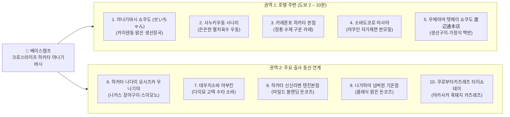

# 후쿠오카 출사 여행 가이드: 속 편하고 담백한 점심 맛집 10선

> **가이드 컨셉**: 매일 **3만 보 이상 걷는 출사 일정**과 저녁 음주 후에도 위장에 무리를 주지 않는 **'자극적이지 않고 속 편한 점심 맛집 10선'**입니다. 베이스캠프 숙소인 **크로스라이프 하카타 야나기바시** 도보권(5곳)과 주요 출사지 동선(5곳)에 맞추어 구성했으며, **현지에서 바로 검색되는 실제 상호명과 정확한 주소 기반의 구글맵 직통 핀**을 전수 반영했습니다.

> [!TIP]
> **주문 시 필수 꿀팁 (염도 조절 요청)**
> 일본 국물이나 간이 다소 짜게 느껴질 때는 주문할 때 아래 문장을 말씀하시면 훨씬 자극 없이 편안하게 드실 수 있습니다.
> - **일본어 표현**: **"우스메데 오네가이시마스"** (`薄めでお願いします`)
> - **의미**: *"간을 싱겁게(연하게) 해주세요."*

## 1. 베이스캠프 및 맛집 10선 한눈에 보기 (실제 상호명 & 구글맵 직통 핀)

### 1.1 베이스캠프 숙소
- **숙소명**: **크로스라이프 하카타 야나기바시** (`クロスライフ博多柳橋` / Cross Life Hakata Yanagibashi)
- **주소**: 〒810-0003 福岡県福岡市中央区春吉1-6-5
- **직통 핀**: [📍 구글맵에서 호텔 위치 열기](https://www.google.com/maps/search/?api=1&query=クロスライフ博多柳橋+福岡市中央区春吉1-6-5)

### 1.2 권역 및 출사 동선 다이어그램

### 1.3 전체 10선 정밀 상호명 · 주소 · 구글맵 링크 표

| 번호 | 실제 상호명 (일본어 정식 표기) | 정확한 현지 주소 | 대표 메뉴 (속 편한 포인트) | 구글맵 직통 링크 |
| :---: | :--- | :--- | :--- | :---: |
| **1** | **야나기바시 쇼쿠도 (せいちゃん)** (`柳橋食堂` / 吉田鮮魚店 2F) | 福岡市中央区春吉1-1-10 (호텔 도보 2분 시장 내) | 당일 아침 활어 카이센동, 조미료 없는 맑은 생선 장국(아라지루) | [📍 구글맵](https://www.google.com/maps/search/?api=1&query=柳橋食堂+福岡市中央区春吉1-1-10) |
| **2** | **사누키우동 시나리** (`讃岐うどん 志成`) | 福岡市中央区大手門3-3-24 (오호리공원역 도보 4분) | 멸치·다시마(이리코) 맑은 육수 온우동, 반숙란 붓카케 우동 | [📍 구글맵](https://www.google.com/maps/search/?api=1&query=讃岐うどん+志成+福岡市中央区大手門3-3-24) |
| **3** | **카레혼포 하카타 본점** (`伽哩本舗 博多本店`) | 福岡市博多区上川端町6-135 (상점가 내 / 구시다신사 앞) | 양파를 오래 볶아 단맛을 낸 부드러운 수제 카레 (자극 없는 맛) | [📍 구글맵](https://www.google.com/maps/search/?api=1&query=伽哩本舗+博多本店+福岡市博多区上川端町6-135) |
| **4** | **소바도코로 마사야** (`そば処 まさや`) | 福岡市中央区薬院2-10-1 (호텔 도보 8분 야쿠인 골목) | 메밀향 그윽한 세이로(판모밀) 소바 & 위장 데워주는 따뜻한 면수(소바유) | [📍 구글맵](https://www.google.com/maps/search/?api=1&query=そば処+まさや+福岡市中央区薬院2-10-1) |
| **5** | **우메야마 텟페이 쇼쿠도 渡辺通本店** (`梅山鉄平食堂 本店`) | 福岡市中央区渡辺通3-6-1 (호텔 도보 4분 와타나베도리) | 소금 고등어구이 정식, 부드러운 다시마키 계란말이, 미소시루 | [📍 구글맵](https://www.google.com/maps/search/?api=1&query=梅山鉄平食堂+本店+福岡市中央区渡辺通3-6-1) |
| **6** | **하카타 나다이 요시즈카 우나기야** (`博多名代 吉塚うなぎ屋`) | 福岡市博多区中洲2-8-27 (나카스 강변 본점) | 1873년 창업 전통 장어구이, 개운한 장어 간 맑은 국(스이모노) | [📍 구글맵](https://www.google.com/maps/search/?api=1&query=博多名代+吉塚うなぎ屋+福岡市博多区中洲2-8-27) |
| **7** | **테우치소바 야부킨** (`手打ち蕎麦 やぶ金`) | 福岡市中央区大名1-3-5 (유형문화재 쇼쇼쿄 고택 내) | 정갈한 세이로 소바, 위장을 포근히 감싸는 타마고토지 계란 소바 | [📍 구글맵](https://www.google.com/maps/search/?api=1&query=手打ち蕎麦+やぶ金+福岡市中央区大名1-3-5) |
| **8** | **하카타 신신라멘 텐진본점** (`博多らーめん Shin-Shin 天神本店`) | 福岡市中央区天神3-2-19 (텐진 본점) | 돼지 잡내 없이 닭뼈·채소를 블렌딩한 담백 마일드 돈코츠 (파 추가) | [📍 구글맵](https://www.google.com/maps/search/?api=1&query=博多らーめん+Shin-Shin+天神本店+福岡市中央区天神3-2-19) |
| **9** | **나가하마 넘버원 기온점** (`長浜ナンバーワン 祇園店`) | 福岡市博多区祇園町4-64 (기온역 도보 2분) | 어시장 스타일의 맑고 가벼운 전통 돈코츠 (`"우스메"` 주문 권장) | [📍 구글맵](https://www.google.com/maps/search/?api=1&query=長浜ナンバーワン+祇園店+福岡市博多区祇園町4-64) |
| **10** | **쿠로부타카츠레츠 타이쇼테이** (`黒ブタかつれつ 大正亭`) | 福岡市中央区赤坂1-3-16 (아카사카역 도보 4분) | 가고시마 흑돼지 카츠레츠 (소금·겨자 곁들임, 양배추와 맑은 장국) | [📍 구글맵](https://www.google.com/maps/search/?api=1&query=黒ブタかつれつ+大正亭+福岡市中央区赤坂1-3-16) |

## 2. 호텔 주변 맛집 5선 (도보 2 – 10분 거리 상세)

### 2.1 야나기바시 쇼쿠도 (`柳橋食堂` / せいちゃん)
- **실제 상호명**: **야나기바시 쇼쿠도** (`柳橋食堂` / 1층 요시다 선어점 2층 식당)
- **정확한 주소**: 福岡県福岡市中央区春吉1-1-10 柳橋連合市場内 (**호텔 도보 2분**)
- **영업시간**: 08:30 – 15:00 (일요일 휴무)
- **추천 메뉴**: 신선한 카이센동(해산물 덮밥) & 맑은 생선 장국(아라지루). 기름기가 전혀 없어 아침 겸 점심으로 가장 훌륭한 속풀이 메뉴입니다.
- **직통 핀**: [📍 야나기바시 쇼쿠도 (柳橋食堂) 구글맵 열기](https://www.google.com/maps/search/?api=1&query=柳橋食堂+福岡市中央区春吉1-1-10)

### 2.2 사누키우동 시나리 (`讃岐うどん 志成`)
- **실제 상호명**: **사누키우동 시나리** (`讃岐うどん 志成`)
- **정확한 주소**: 福岡県福岡市中央区大手門3-3-24 (지하철 오호리공원역 4번 출구 도보 4분)
- **영업시간**: 11:00 – 15:00 (월요일 휴무)
- **추천 메뉴**: 이리코(멸치·다시마)를 정성껏 우려내 맑고 향긋한 **따뜻한 온우동**, 반숙 계란튀김을 얹은 **붓카케 우동**.
- **직통 핀**: [📍 사누키우동 시나리 (讃岐うどん 志成) 구글맵 열기](https://www.google.com/maps/search/?api=1&query=讃岐うどん+志成+福岡市中央区大手門3-3-24)
- *(호텔 인근 도보 우동 대안)*: **우동 타이라** (`うどん平`, 福岡市博多区住吉5-10-7, 호텔 도보 8분) ➔ [📍 우동 타이라 구글맵 열기](https://www.google.com/maps/search/?api=1&query=うどん平+福岡市博多区住吉5-10-7)

### 2.3 카레혼포 하카타 본점 (`伽哩本舗 博多本店`)
- **실제 상호명**: **카레혼포 하카타 본점** (`伽哩本舗 博多本店`)
- **정확한 주소**: 福岡県福岡市博多区上川端町6-135 2F (카와바타 상점가 내, 櫛田神社前역 도보 3분)
- **영업시간**: 11:00 – 16:00 (목요일 휴무)
- **추천 메뉴**: 양파를 장시간 볶아 자연스러운 단맛을 낸 뒤 깊은 육수로 완성한 정통 수제 카레. 인스턴트 루 특유의 짠맛이나 조미료 자극이 없어 소화가 매우 편안합니다.
- **직통 핀**: [📍 카레혼포 하카타 본점 (伽哩本舗 博多本店) 구글맵 열기](https://www.google.com/maps/search/?api=1&query=伽哩本舗+博多本店+福岡市博多区上川端町6-135)

### 2.4 소바도코로 마사야 (`そば処 まさや`)
- **실제 상호명**: **소바도코로 마사야** (`そば処 まさや`)
- **정확한 주소**: 福岡県福岡市中央区薬院2-10-1 (**호텔 도보 8분**)
- **영업시간**: 11:30 – 15:00, 17:30 – 21:00
- **추천 메뉴**: 메밀 함량이 높은 슴슴한 세이로(판모밀) 소바. 식사 후 내어주는 뜨거운 면수(소바유)를 쯔유에 타서 마시면 속이 따뜻하게 풀립니다.
- **직통 핀**: [📍 소바도코로 마사야 (そば処 まさや) 구글맵 열기](https://www.google.com/maps/search/?api=1&query=そば処+まさや+福岡市中央区薬院2-10-1)
- *(야쿠인 가성비 대안)*: **웨스트 야쿠인점** (`ウエスト 薬院店`, 福岡市中央区白金1-1-27, 호텔 도보 7분) ➔ [📍 웨스트 야쿠인점 구글맵 열기](https://www.google.com/maps/search/?api=1&query=ウエスト+薬院店+福岡市中央区白金1-1-27)

### 2.5 우메야마 텟페이 쇼쿠도 渡辺通本店 (`梅山鉄平食堂 本店`)
- **실제 상호명**: **우메야마 텟페이 쇼쿠도 본점** (`梅山鉄平食堂 渡辺通本店`)
- **정확한 주소**: 福岡県福岡市中央区渡辺通3-6-1 (**호텔 도보 4분**)
- **영업시간**: 11:30 – 15:30, 17:00 – 21:30 (수요일 휴무)
- **추천 메뉴**: 매일 현지 어시장에서 공수하는 생선구이(고등어 소금구이, 옥돔, 금태 등), 부드러운 일본식 계란말이(다시마키), 맑은 미소시루 정식.
- **직통 핀**: [📍 우메야마 텟페이 쇼쿠도 본점 (梅山鉄平食堂 本店) 구글맵 열기](https://www.google.com/maps/search/?api=1&query=梅山鉄平食堂+本店+福岡市中央区渡辺通3-6-1)

## 3. 출사 동선 연계 핵심 맛집 5선 (상세)

### 3.1 하카타 나다이 요시즈카 우나기야 (`博多名代 吉塚うなぎ屋`)
- **실제 상호명**: **요시즈카 우나기야** (`博多名代 吉塚うなぎ屋`)
- **정확한 주소**: 福岡県福岡市博多区中洲2-8-27 (나카스 강변, 기온 사찰군 도보권)
- **영업시간**: 10:30 – 21:00 (수요일 휴무)
- **추천 메뉴**: 은은한 양념의 장어구이와 개운한 장어 간 맑은 국(스이모노). 오픈런(10:30) 이른 점심 추천.
- **직통 핀**: [📍 요시즈카 우나기야 (博多名代 吉塚うなぎ屋) 구글맵 열기](https://www.google.com/maps/search/?api=1&query=博多名代+吉塚うなぎ屋+福岡市博多区中洲2-8-27)

### 3.2 테우치소바 야부킨 (`手打ち蕎麦 やぶ金`)
- **실제 상호명**: **테우치소바 야부킨** (`手打ち蕎麦 やぶ金`)
- **정확한 주소**: 福岡県福岡市中央区大名1-3-5 松楠居 1F (다이묘 골목 고택, 아카사카역 도보 6분)
- **영업시간**: 11:30 – 15:00, 17:30 – 21:00 (화요일 휴무)
- **추천 메뉴**: 정갈한 세이로 수타 소바, 계란을 푼 부드러운 타마고토지 온소바.
- **직통 핀**: [📍 테우치소바 야부킨 (手打ち蕎麦 やぶ金) 구글맵 열기](https://www.google.com/maps/search/?api=1&query=手打ち蕎麦+やぶ金+福岡市中央区大名1-3-5)

### 3.3 하카타 신신라멘 텐진본점 (`博多らーめん Shin-Shin 天神本店`)
- **실제 상호명**: **하카타 라멘 신신 텐진본점** (`博多らーめん Shin-Shin 天神本店`)
- **정확한 주소**: 福岡県福岡市中央区天神3-2-19 (지하철 텐진역 4번 출구 도보 5분)
- **영업시간**: 11:00 – 03:00 (연중무휴)
- **추천 메뉴**: 닭뼈와 채소를 배합해 담백하고 깔끔한 마일드 돈코츠 라멘. 파(네기) 추가 권장.
- **직통 핀**: [📍 하카타 신신라멘 텐진본점 (博多らーめん Shin-Shin 天神本店) 구글맵 열기](https://www.google.com/maps/search/?api=1&query=博多らーめん+Shin-Shin+天神本店+福岡市中央区天神3-2-19)

### 3.4 나가하마 넘버원 기온점 (`長浜ナンバーワン 祇園店`)
- **실제 상호명**: **나가하마 넘버원 기온점** (`長浜ナンバーワン 祇園店`)
- **정확한 주소**: 福岡県福岡市博多区祇園町4-64 (지하철 기온역 5번 출구 도보 2분)
- **영업시간**: 11:30 – 23:30
- **추천 메뉴**: 맑고 가벼운 클래식 돈코츠 라멘. 주문 시 `"우스메데 오네가이시마스(간 연하게)"` 요청 필수.
- **직통 핀**: [📍 나가하마 넘버원 기온점 (長浜ナンバーワン 祇園店) 구글맵 열기](https://www.google.com/maps/search/?api=1&query=長浜ナンバーワン+祇園店+福岡市博多区祇園町4-64)

### 3.5 쿠로부타카츠레츠 타이쇼테이 (`黒ブタかつれつ 大正亭`)
- **실제 상호명**: **쿠로부타카츠레츠 타이쇼테이** (`黒ブタかつれつ 大正亭`)
- **정확한 주소**: 福岡県福岡市中央区赤坂1-3-16 (지하철 아카사카역 2번 출구 도보 4분)
- **영업시간**: 11:00 – 15:00, 17:00 – 21:00 (일요일 휴무)
- **추천 메뉴**: 가고시마 흑돼지 안심 카츠레츠. 소스 대신 소금과 겨자만 곁들여 속 편하게 양질의 단백질 섭취.
- **직통 핀**: [📍 쿠로부타카츠레츠 타이쇼테이 (黒ブタかつれつ 大正亭) 구글맵 열기](https://www.google.com/maps/search/?api=1&query=黒ブタかつれつ+大正亭+福岡市中央区赤坂1-3-16)

---

**서기 2026년 10월 13일**

**무리하지 않는 편안한 식사와 함께, 매 걸음마다 건강하고 멋진 풍경을 담아내는 출사 여행이 되기를 바라며 기록함.**
