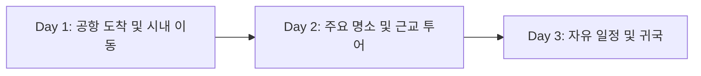

# [여행지] [N박 M일] 여행 계획: [여행 테마/부제]

> **한 줄 요약**: [예: 무리하지 않는 여유로운 동선과 현지 제철 미식에 집중하는 가을 여행]

## 1. 여행 개요 (Trip Overview)

| 항목 | 상세 내용 | 비고 |
| :--- | :--- | :--- |
| **여행 기간** | YYYY년 MM월 DD일(요일) – MM월 DD일(요일) (N박 M일) | |
| **목적지** | [국가 / 주요 도시 및 지역] | |
| **이동 수단** | [항공편명 / KTX / 렌터카 / 대중교통 패스 등] | 상세 예약번호는 단톡방 공유 |
| **숙소** | [숙소명 및 위치 권역] | 체크인 15:00 / 체크아웃 11:00 |
| **핵심 컨셉** | [예: 자연 풍경 감상, 현지 맛집 탐방, 온천 휴식] | |

### 전체 이동 동선 요약

## 2. 일자별 상세 일정 (Daily Itinerary)

### Day 1 (MM/DD 요일): [1일차 핵심 테마]

| 시간 | 장소 / 일정 | 상세 내용 및 팁 | 이동 수단 (소요시간) |
| :---: | :--- | :--- | :--- |
| **09:00 – 11:30** | **[[출발 공항](https://www.google.com/maps/search/?api=1&query=공항명)]** 및 **[[도착 공항](https://www.google.com/maps/search/?api=1&query=공항명)]** | 출국 수속 및 현지 공항 도착 | 항공 (약 2시간 30분) |
| **11:30 – 13:00** | 시내 이동 및 **[[숙소](https://www.google.com/maps/search/?api=1&query=호텔명+주소)]** 짐 보관 | 공항철도 탑승 후 호텔 프런트에 캐리어 보관 | 급행열차 (약 45분) |
| **13:00 – 14:30** | 점심 식사: **[[식당명](https://www.google.com/maps/search/?api=1&query=식당명+주소)]** | 대표 메뉴: [메뉴명] (웨이팅 시 대안: [대안 식당]) | 도보 (10분) |
| **14:30 – 17:30** | **[[주요 방문지 1](https://www.google.com/maps/search/?api=1&query=장소명)]** 산책 | 포토스팟 관람 및 근처 카페 휴식 | 도보 이동 |
| **18:00 – 20:00** | 저녁 식사: **[[식당명](https://www.google.com/maps/search/?api=1&query=식당명+주소)]** | 사전 예약 완료 (18:00) | 택시 (15분) |
| **20:30 –** | 숙소 체크인 및 휴식 | 근처 편의점 간식 구매 및 자유 시간 | 도보 (5분) |

> [!TIP]
> **1일차 우천 또는 컨디션 조절 시 대안**: 야외 산책 대신 인근 **[[실내 미술관 / 쇼핑몰](https://www.google.com/maps/search/?api=1&query=장소명)]** 코스로 유연하게 변경합니다.

### Day 2 (MM/DD 요일): [2일차 핵심 테마]

| 시간 | 장소 / 일정 | 상세 내용 및 팁 | 이동 수단 (소요시간) |
| :---: | :--- | :--- | :--- |
| **09:00 – 10:00** | 숙소 조식 및 출발 준비 | 편한 신발 착용 권장 | - |
| **10:00 – 12:30** | **[[주요 방문지 2](https://www.google.com/maps/search/?api=1&query=장소명)]** 탐방 | 오전 시간대 방문으로 혼잡 회피 | 버스/전철 (30분) |
| **12:30 – 14:00** | 점심 식사: **[[식당명](https://www.google.com/maps/search/?api=1&query=식당명+주소)]** | 현지 특산 요리 | 도보 (10분) |
| **14:00 – 17:30** | **[[주요 방문지 3](https://www.google.com/maps/search/?api=1&query=장소명)]** 및 카페 | 전망대 관람 및 티타임 | 도보 (15분) |
| **18:00 – 20:00** | 저녁 식사: **[[식당명](https://www.google.com/maps/search/?api=1&query=식당명+주소)]** | 로컬 맛집 탐방 | 전철 (20분) |

## 3. 예상 예산 및 비용 안내 (Estimated Budget)

> *1인 기준 대략적인 예상 비용이며, 현지 상황에 따라 소폭 변동될 수 있습니다.*

| 구분 | 항목 | 1인 예상 비용 | 비고 |
| :--- | :--- | :---: | :--- |
| **교통비** | 항공권 / 기차표 / 현지 교통패스 | 00만 – 00만 원 | 사전 예매 기준 |
| **숙박비** | 숙소 (N박 기준 1인 분담금) | 00만 – 00만 원 | 조식 포함 여부 확인 |
| **식비·카페** | 현지 식사 및 디저트·주류 | 00만 – 00만 원 | 공금 또는 더치페이 |
| **입장료·기타** | 주요 명소 입장권 및 예비비 | 0만 – 00만 원 | |
| **합계** | **1인 총 예상 경비** | **약 00만 – 00만 원** | 개인 쇼핑비 별도 |

## 4. 준비물 체크리스트 및 참고사항 (Checklist & Notes)

### 필수 준비물
- [ ] 여권 (유효기간 6개월 이상) 또는 신분증
- [ ] 항공권(E-티켓) 및 숙소 바우처 (모바일 저장 완료)
- [ ] 해외 결제 가능 카드(트래블월렛/트래블로그 등) 및 소액 현지 현금
- [ ] 로밍 / eSIM / 포켓와이파이 설정
- [ ] 돼지코(멀티 어댑터), 보조배터리, 충전 케이블
- [ ] 개인 상비약 (소화제, 진통제, 밴드) 및 우산/양산

> [!IMPORTANT]
> **보안 안내**: 본 문서는 공개(Public) 링크로 공유되므로, 항공·숙소 **예약 번호(PIN)**나 **정산용 계좌번호**는 이 문서에 적지 않고 단톡방 공지로 별도 공유합니다.

---

**서기 YYYY년 MM월 DD일**

**함께 떠나는 걸음마다 즐거운 대화와 편안한 쉼이 함께하기를 바라며 기록함.**
